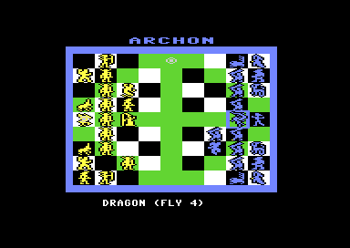
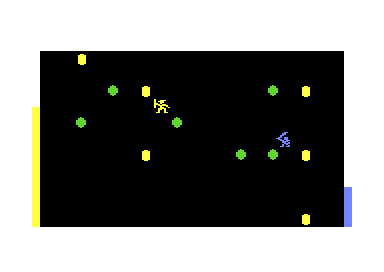
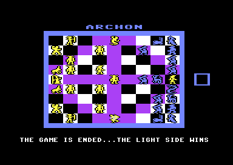

# Archon OME

> Part of the **[Commodore 64 Game Server](../../README.md)**. *Online Multiplayer Enabled*: the light and the dark side, each on their own C64.

**Archon** (Free Fall Associates / Electronic Arts, 1983): a chess-like board where every
capture is a real-time battle in the arena, and two spell casters, the Wizard and the
Sorceress.

<p align="center">
  
  
  
</p>

## Playing

Load the disk's first file (`LOAD"*",8,1` / `RUN`): the framework's standard lobby
([framework/c64/lobby](../../framework/c64/lobby/README.md)). Invite a player with FIRE.
- Slot 0 (the inviter) plays **the light side**, slot 1 **the dark side**. Each player uses
  joystick **port 2**; both C64s show the same board and the same battles.
- The session picks who moves first (from its seed).
- `Q` (either player) ends the game for both. After "THE GAME IS ENDED" the result stays on
  the screen for three seconds, then both C64s go back to the lobby.
- Key `L` in the start menu loads the **original game** (`archl`: two players on one C64, or one
  against the computer; without the cracker's line).

**Head-to-head, without a server:** two C64s on the same network can play without the game server. In the start menu one presses **H** and **1** (host), the other **H** and **2**: it finds the host on the LAN by itself. The host plays **the light side**, the other **the dark side**. Works on two C64 Ultimates whose firmware has the Command Interface command `$0A` ([GideonZ/1541ultimate#962](https://github.com/GideonZ/1541ultimate/issues/962)) and between two VICEs with RR-Net; see the [standard lobby](../../framework/c64/lobby/README.md#head-to-head-directc). Test: `python ../../framework/tools/nettest.py . 60 --direct`.

## Status

| Step | State |
|---|---|
| 1. Deterministic demo (computer against computer) | **done**: `python tools/dettest.py 5000` |
| 2. Deterministic with human inputs | **done**: `python tools/dettest.py 10000 humans=1` (a bot against the computer: a whole game, battles, spells) and `humans=2` (two bots) |
| 3. Online | **done**: VICE ↔ VICE over RR-Net (21,000 ticks, all checksums equal) and WiC64, against the server's bot, the game's end back to the lobby |

## The tape

The tape image (cracked by "The ... Associates") has one file, `$0801-$A9FF`: `SYS 2064`
moves a block of the game to its place and jumps to `$6100`, the game's start.
`tools/crackfix.py` removes the cracker's line ("CRACKED (C) 1984 BY THE ... ASSOCIATES")
from the title; the snapshot (`tools/snapshot.py`) runs the clean file.

## How the online version works

Like M.U.L.E., Archon runs its frame logic in the raster IRQ (one per frame, line `$FB`,
through the vector `$BCCC`): moving the icons, the board's animations and the battles in the
arena (through `$BD30`). The main program starts such a task (`$BCD0 = 0`) and waits until
it is done. On top of that the game uses the KERNAL's **jiffy clock** (`$A0-$A2`, counted by
the CIA timer IRQ at 60 Hz) for waits, timers and random numbers. The online build
(`src/main.s`) makes all of it **virtual**:
- the raster IRQ only counts real frames; the frame logic runs as a **tick** where the main
  program waits, one per real frame (`arch_tick`; the wait loops: `tools/waits.py`, through
  `framework/tools/waitpatch.py`);
- the CIA timer IRQ is only acknowledged; the jiffy clock advances in ticks, 6 jiffies per
  5 ticks (60 Hz on PAL as before); `$91` (the STOP key) stays "not pressed";
- the SID's noise (18 places) is our own random generator, seeded by the session;
- the joysticks (11 places, `LDA $DC00,X/Y`) are this tick's inputs (`arch_in`: index 0 is
  port 2, the dark side; index 1 port 1, the light side);
- the options are set at the start (`$6129`, after the IRQ set-up), as F3/F5/F7 would:
  two players, who moves first; no title, no demo;
- the KERNAL's IRQ stays off until the game's own set-up (it would count jiffies, on PAL
  and NTSC differently).

The state checksum covers the zero page and the game's variables `$BCC0-$BFFF`. All our
code lies in `$C000-$CFFF`, which the game never touches (VICE watchpoints).

## Building

```bash
python tools/crackfix.py      # build/clean/archon.prg: the tape's file without the cracker's line
python tools/snapshot.py      # orig/archon-6100.bin (+ -io.bin) from that file
python tools/build.py disk    # build/archon.d64: lobby, the original (archl), archu / archw / archr
python tools/dettest.py 10000 humans=1   # determinism test (no humans=: the demo; humans=2)
python ../../framework/tools/nettest.py . 300   # server + two VICEs over RR-Net (--wic64, --bot)
```

## Credits

**Archon** © 1983 Free Fall Associates (Anne Westfall, Jon Freeman, Paul Reiche III),
published by Electronic Arts. This is a non-commercial fan project; all rights stay with
the owners.
