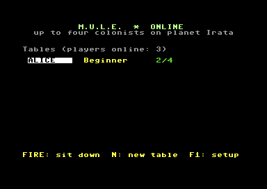
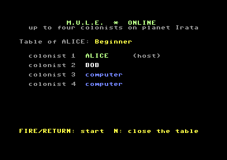
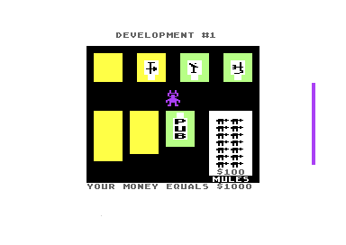

# M.U.L.E. OME

> Part of the **[Commodore 64 Game Server](../../README.md)**. *Online Multiplayer Enabled*: up to four colonists, each on their own C64; the computer plays the empty seats.

**M.U.L.E.** (Ozark Softscape / Electronic Arts, 1983): four colonists on the planet Irata
grab land, build M.U.L.E.s and trade food, energy, smithore and crystite. Up to four
players; the computer plays the empty seats.

## Status

| Step | State |
|---|---|
| 1. Deterministic game (computer players) | **done**: `python tools/dettest.py 50000`: PAL, PAL with 0-3 frames of network-like waiting per tick, and NTSC end in the same game state after 50,000 ticks (nearly a whole beginner game of six months) |
| 2. Deterministic with human inputs | **done**: `python tools/dettest.py <ticks> humans=N` with a bot's random inputs for the human players: PASS for 1 (40,000 ticks), 2 (30,000), 3 (20,000) and 4 human players (10,000: the bots ruin the colony quickly) |
| 3. Network code for 4 players (`framework/c64/net`) | **done**: `NET_PLAYERS = 4` in `net.s` (a ring per slot; the server relays INPUT as `$80 + slot` for games with more than two seats); verified VICE ↔ VICE over RR-Net with the existing invite (2 humans, 2 computer players): 15,680 ticks, 245 matching checksums, about 37 ticks/s in VICE |
| 4. Server and lobby: tables (host opens one, up to 3 join; empty seats are the computer's) | **done**: TABLE_OPEN/JOIN/LEAVE/START, TABLES, TABLE (docs/protocol.md), `framework/c64/lobby/tables.c`; verified with 3 and 4 VICEs over RR-Net (4 players: 7,020 ticks, 660 matching checksums, about 30 ticks/s with four VICEs on one PC) |
| 5. End-to-end test, docs, release | **done**: also over WiC64 (3 VICEs: 6,620 ticks, 312 matching checksums, about 27 ticks/s); in `RELEASE/` (`mule.d64`, `mule-original.d64`) |

## Playing

<p align="center">
  
  
  
</p>

Load the disk's first file: the framework's standard lobby, with **tables**.
- `N` opens a table: choose the level (Beginner, Standard, Tournament) with the joystick or the
  cursor keys, FIRE opens it. Up to three others sit down (FIRE on a table).
- The host starts with FIRE whenever he likes, also alone: the computer plays the empty seats.
- The players are colonists 1-4 in the order they sat down; each uses joystick port 2.
- `Q` (any player) ends the game for all; after the last month everyone is back at the lobby.

**Head-to-head, without a server:** two C64s on the same network can play without the game server. In the start menu one presses **H** and **1** (host), the other **H** and **2**: it finds the host on the LAN by itself. The host chooses the level first and is colonist 1, the other colonist 2; the computer plays colonists 3 and 4. Works on two C64 Ultimates whose firmware has the Command Interface command `$0A` ([GideonZ/1541ultimate#962](https://github.com/GideonZ/1541ultimate/issues/962)) and between two VICEs with RR-Net; see the [standard lobby](../../framework/c64/lobby/README.md#head-to-head-directc). Test: `python ../../framework/tools/nettest.py . 60 --direct`.

## The disk

The tape image's disk (cracked by "Jedi", 1984) has two files:

| File | Address | What |
|---|---|---|
| `m.u.l.e.` | `$0801-$84FF` | `SYS 2068` -> `JMP $5349`: title, options (F3 level -> `$E504`, F5 players -> `$43FF`), "each planeteer press your button" (input devices -> `$E500-$E503`); then `$65E4` loads `&` |
| `&` | `$4000-$CBFF` | the game: `JMP $4000` -> `JMP $972B`; at the end of a game its own title, which loads `m.u.l.e.` again |

`tools/crackfix.py` removes what the cracker added: "CRACKED 1984 BY JEDI" on the credits
and on the second title, the "JEDISCAPE" logo, and the pirates he renamed ("JEDI SHIP",
"JEDIS TAKE ALL" -> "PIRATE SHIP", "PIRATES TAKE ALL"). Every string keeps its length.

## How the online version works (so far)

In the original the raster IRQ (`$5F17`) runs the **frame logic** every frame:
- the clocks `$14/$13/$12`, and a random mix `$FD` with the SID's noise;
- the inputs of the four players (`$E500,X` = device: negative = computer, 8/9 = joystick
  ports, else keyboard sets; `$49,X` button, `$54,X` direction);
- count-downs `$5A,X`, `$5C`, `$60CF`, the button latch `$4D/$2C/$35`, the music;
- the **frame task** of the phase (`$58`, table `$60D1`: walking, the auction, events ...).

The main program waits for it in many places, so how far each gets depends on timing.
The online build (`src/main.s`) uses **virtual frames**:
- the IRQ only draws and counts real frames (`mule_due`);
- the frame logic runs as a **tick**, only where the main program waits, one per real
  frame (`mule_tick`). "Wait n frames" (`$44EE`) is n ticks;
- the main program's wait loops tick while they wait (`tools/waits.py`: tight loops,
  loop heads, calls and jumps back; found with a flow trace of the game and by running
  the test build until it hung);
- a human player X has the input device 8+X (`$E500,X`); the frame logic and `$74F0` read
  the device's port at `$DBF8+device`, which becomes our table of this tick's inputs
  (`mule_in`: from the network, or the test bot). The keyboard scanner (`$8850`: keyboard
  players, F1 pause, F3/F5/F7 restart) reads nothing; `$A8` stays "no key";
- the SID's noise becomes our own generator; the keys and fire buttons read directly
  (`$6911`) are never pressed (the players' buttons come through the frame logic);
  no pause key and no attract mode.

## Where our code lives

The game uses almost all memory, so the online build fills the gaps (`src/areas-online.json`):

| Area | What it was | Now |
|---|---|---|
| `$E9C9-$EC53` | never touched | `NET`: the lockstep (`net.s` with `NET_SPLIT`) |
| `$CC00-$CDFF` | never touched | `NETRX` (receiving, `net_end`) and `MULE` (the tick code) |
| `$8850-$897A` | the keyboard scanner (online never called) | `NETDRV`: the network driver |
| `$8A56-$8B3B`, `$8B95-$8C2A` | the title of a new game (only after a game: online the session ends there) | `WAITS`, `WAITS2`: wait loop stubs |
| `$60F3-$617C` | the attract mode (online off) | `WAITS3`, the test bot |
| `$6087-$60C8` | the IRQ's pause code (online off) | `MULE2`: small routines |
| `$0300-$03FF` | never used | `NETBSS`: the network state (never loaded; `net_start` clears it) |

The raster handler `$8B3C-$8B94` in the middle of the old title stays: other screens use it
(`$9E08`). After the last month the game jumps to `$972B`; online that ends the session.

## Disks

The three online game files are 153 blocks each, so the original game (`m.u.l.e.`, `&`,
without the cracker's texts) is on a disk of its own: `build/mule-original.d64`.

## Building

```bash
python tools/snapshot.py      # orig/mule-972b.bin (+ -io.bin) from the clean disk: four computer players
python tools/build.py         # build/mule.prg: that game as one PRG
python tools/crackfix.py      # build/mule-clean.d64: the original two files without the crack's texts
python tools/dettest.py 50000 # determinism test (humans=N: N players with a bot's inputs)
python tools/build.py disk    # build/mule.d64 (lobby + muleu/mulew/muler), build/mule-original.d64
python ../../framework/tools/nettest.py . 420   # server + two VICEs over RR-Net
```

`tools/dettest.py` ignores only the CPU port, the stack, our tick code and the raster IRQ
handlers' own bytes (`$1C/$1D`: their saved registers, `$29`: the step of the screen split).

Free memory in the game: `$CC00-$CDFF` and `$E9C9-$EC53` (never touched, VICE
watchpoints over a whole game); the game's init clears `$EC55-$FEFE`, so the entry code
and the copy of low memory lie there.

## Credits

**M.U.L.E.** © 1983 Ozark Softscape (Dan Bunten, Bill Bunten, Jim Rushing, Alan Watson;
music by Roy Glover), published by Electronic Arts. This is a non-commercial fan
project; all rights stay with the owners.
