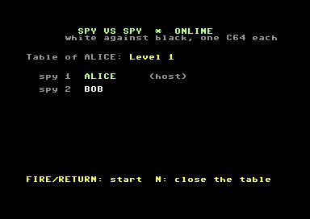
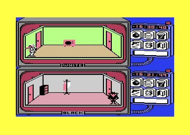
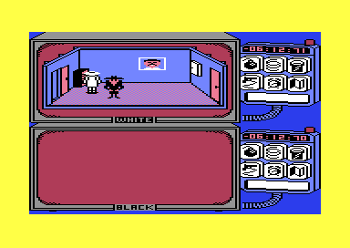
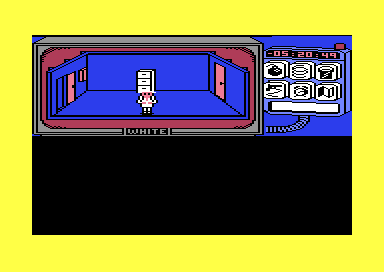
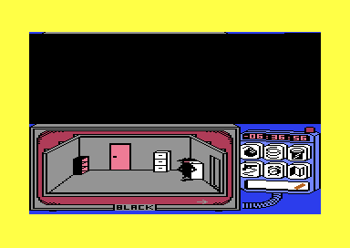

# Spy vs Spy OME

> Part of the **[Commodore 64 Game Server](../../README.md)**. *Online Multiplayer Enabled*: the white spy and the black spy, each on their own C64.

**Spy vs Spy** (First Star Software, 1984), after Antonio Prohías' cartoon in MAD Magazine:
two spies search an embassy for a briefcase, a passport, a key and money, set traps for
each other and fight when they meet. The screen is split: white's room above, black's below.

<p align="center">
  
  
  
</p>
<p align="center">
  
  
</p>

## Playing

Load the disk's first file (`LOAD"*",8,1` / `RUN`): the framework's standard lobby
([framework/c64/lobby](../../framework/c64/lobby/README.md)) with **tables**.
- A host opens a table and chooses the level (1-8: more rooms, more traps, more time)
  and the screen: **"Level n"** is the split screen of the original, **"Level n, private"**
  is the own screen (see below). A second player sits down; the host starts.
- The host plays **the white spy**, the guest **the black spy**. Each player uses joystick
  **port 2**; both C64s show the same split screen.
- **Private** (own screen): while the spies are in different rooms, each C64 shows only its
  own spy's half; the other half is black. You do not see where the other spy goes, what it
  finds or where it sets its traps. In one room (the game then shows that room in one half)
  both see everything, as in the original, and so they do once a spy has escaped or its
  time is up. Only the picture changes: both C64s still compute the same game.
- Alone at the table, the host plays white against the computer's black spy.
- `Q` (either player) ends the game for both. After the game the result stays on the
  screen for three seconds, then both C64s go back to the lobby.
- Key `L` in the lobby loads the **original game** (`spyl`: the options screen, one or two
  players on one C64, the demo; without the cracker's line).

## Status

| Step | State |
|---|---|
| 1. Deterministic | **done**: `python tools/dettest.py 10000 humans=1` (a bot against the computer), `humans=2` (two bots, 30,000 ticks) |
| 2. Two players, options from the session | **done**: levels 1, 4 and 8 tested (`level=`) |
| 3. Online | **done**: VICE ↔ VICE at a table over RR-Net and WiC64, alone against the computer, the game's end back to the lobby |
| 4. Docs and release | **done** |
| 5. Private (own screen) | **done**: the table's option 8-15; `python tools/dettest.py 8000 private=0` / `private=1` (the picture does not touch the game), VICE ↔ VICE and alone with `--option 8` |

## The disk

The disk (cracked by 1701) has one file, `$0801-$A5F7`: `SYS 2066` runs two unpackers,
then the cracker's mover (`$3400`), which jumps to `$660F`, the game's start (the options
screen). There is no intro and no trainer; the only trace of the crack is the line
"1701 CRACKWARE" on the options screen, which a patch blanks. The snapshot
(`tools/snapshot.py`) is taken at `$660F`.

## How the online version works

The main loop (`$66DC-$6877`) moves one spy per pass (`$41`: 0 white, 1 black). Its inputs
are `$02,X`: the joystick, the computer's spy, or the game's own **demo recorder**, which
records and replays inputs per pass, with a fixed random seed. The game was made to be
replayed pass by pass, and that is what lockstep needs. The raster IRQ (two per frame,
one per screen half) draws the sprites of each half, plays the sound and the music, reads
the joysticks and keys, and counts both spies' clocks down. The online build
(`src/main.s`):
- a **tick** is one pass of the main loop (`spy_tick` at `$674E`); the network step comes
  once per round (white's pass and black's), since each spy uses its input in its own
  pass only;
- the **clocks** (`$9362`) run in the tick: 7 virtual frames per 5 passes, about the
  original pace (a pass takes 1.4 frames);
- the joysticks are the tick's inputs (`$0285` white, `$0286` black), keys none
  (F5 restart and RUN/STOP pause are off); the random seed is the session's
  (it was the raster line plus the sum of the zero page);
- the IRQ keeps drawing, the sound and the music: nothing in the game logic reads their
  memory, which the state checksum leaves out;
- no options screen: players, level (the table's option), the computer's IQ and the
  hidden airport are set as the options screen would set them; no demo;
- **private**: the table's option is 0-15, bits 0-2 the level, bit 3 the own screen. Each
  IRQ starts a screen half (`$35`); our code there (`spy_irqhalf`) shows the other spy's
  half in an invalid mode (ECM with bitmap: black), and at the IRQ's end (`spy_irqend`)
  without sprites, while the rooms differ (`$F8` negative; otherwise it is the half that
  shows the one room) and both clocks run (`$025D`/`$025E`).

Memory: our code lies in the demo's recorded inputs (`$C000-$C983`), which the online game
never plays. The original game (`spyl`) keeps its demo: its entry lies in the unused ends
of that table. The game's VIC set-up made CIA 2's PA2 an input; online it stays an output
(the WiC64's handshake).

## Building

```bash
python tools/snapshot.py      # orig/spyvsspy-660f.bin (+ -io.bin) from orig/spyvsspy.prg
python tools/build.py disk    # build/spyvsspy.d64: lobby, the original (spyl), spyu / spyw / spyr
python tools/dettest.py 10000 humans=1   # determinism test (humans=2, level=1-8, private=0|1)
python ../../framework/tools/nettest.py . 300 --players 2   # server + two VICEs at a table (--wic64; --players 1;
                                                            # --option 8-15: private)
```

## Credits

**Spy vs Spy** © 1984 First Star Software, designed by Michael Riedel, after the cartoon by
Antonio Prohías (MAD Magazine). This is a non-commercial fan project; all rights stay with
the owners.
